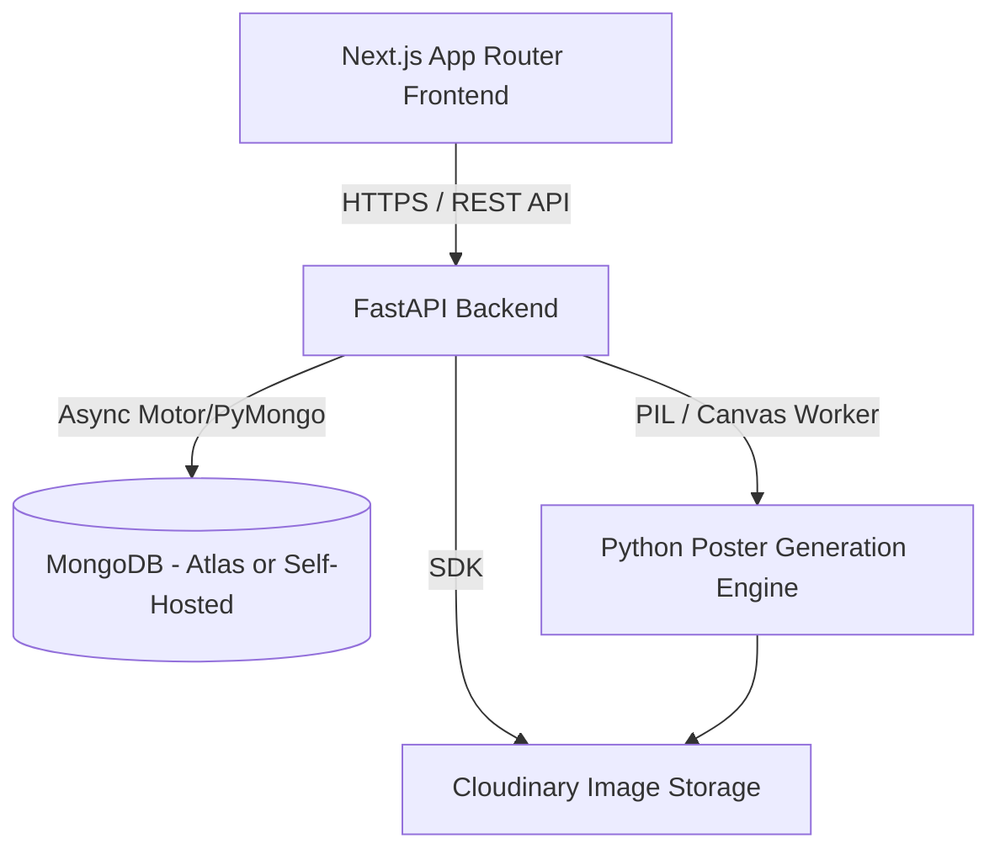

# SportBid - Architecture & Foundation (Phase 0)

## 1. Executive Summary & Vision

**SportBid** is a multi-tenant sports management platform engineered for grassroots, corporate, and competitive sports organizers. The platform streamlines player registration, automated template-driven poster generation, organizer approval workflows, and future live player auctions.

Supported sports initially include:
- Volleyball
- Cricket
- Football
- Kabaddi
- Basketball
- Configurable custom sports (with dynamic attribute definitions)

---

## 2. User Roles & Permission Model

The platform enforces strict role-based authorization:

### 2.1 Player
- **Profile Management**: Permanent master record (Full name, phone, city/region, photo, primary/secondary sports and skill attributes like batting style, bowling hand, spike reach, position).
- **Tournament Discovery**: Browse public tournaments, filter by sport, date, entry criteria.
- **Registration**: Register for a tournament by snapping the profile into a `TournamentRegistration` record without re-typing base profile data.
- **Status & Poster Tracking**: View registration status (`PENDING`, `APPROVED`, `REJECTED`), download generated posters once approved.
- **Auction Participation**: View bidding results in auction phase.

### 2.2 Organizer
- **Tournament Lifecycle**: Create, configure, update, schedule tournaments.
- **Custom Form Fields**: Configure sport-specific or tournament-specific registration criteria.
- **Review & Approval**: Inspect submitted registrations with player details and rendered draft poster preview.
- **Poster Approval & Publishing**: Approve posters, trigger automated publishing to public tournament galleries.
- **Team & Auction Operations** (Phases 2+): Team creation, auction purse allocation, live bidding controller.

### 2.3 Super Administrator
- **Governance**: Platform-wide user management, organizer verification, audit log inspection.
- **System Configuration**: Global poster templates, feature toggles, security rate-limits.
- **Abuse & Escalation Handling**: Review flagged tournaments or players.

---

## 3. High-Level System Architecture

### 3.1 Service Boundaries
- **Frontend**: Next.js (App Router), TypeScript (Strict), Tailwind CSS, Lucide icons, shadcn/ui component architecture.
- **Backend API**: FastAPI (Python), asynchronous route handlers, Pydantic v2 schemas, Motor/PyMongo async connection pooling.
- **Poster Rendering Engine**: Deterministic Python Pillow (PIL) pipeline executing sport-specific templates, exact typography bounding, asset composition, and watermarking.
- **Storage**: Cloudinary CDN for optimized asset storage (player profile photos, generated high-resolution posters, tournament branding).

---

## 4. Core Domain Entities & Relationships

MongoDB collections and schema definitions:

### 1. `users`
- `_id`: ObjectId
- `email`: String (Unique, Indexed)
- `phone_number`: String (Unique, Indexed)
- `hashed_password`: String
- `role`: Enum (`player`, `organizer`, `super_admin`)
- `is_active`: Boolean
- `is_verified`: Boolean
- `created_at`: DateTime
- `updated_at`: DateTime

### 2. `player_profiles`
- `_id`: ObjectId
- `user_id`: ObjectId (Ref `users._id`, Unique)
- `full_name`: String
- `display_name`: String
- `avatar_url`: String
- `date_of_birth`: Date
- `gender`: String
- `city`: String
- `state`: String
- `sports_data`: Object mapping sport key (e.g., `cricket`, `volleyball`) to attributes (role, hand, jersey number).
- `created_at`, `updated_at`: DateTime

### 3. `organizer_profiles`
- `_id`: ObjectId
- `user_id`: ObjectId (Ref `users._id`, Unique)
- `organization_name`: String
- `verified_status`: Enum (`pending`, `verified`, `rejected`)
- `contact_email`: String
- `contact_phone`: String
- `created_at`, `updated_at`: DateTime

### 4. `tournaments`
- `_id`: ObjectId
- `organizer_id`: ObjectId (Ref `users._id`, Indexed)
- `title`: String
- `slug`: String (Unique, Indexed)
- `sport`: Enum (`cricket`, `volleyball`, `football`, `kabaddi`, `basketball`, `custom`)
- `description`: String
- `location`: Object (`venue`, `city`, `state`)
- `start_date`: DateTime
- `end_date`: DateTime
- `registration_deadline`: DateTime
- `status`: Enum (`draft`, `published`, `registrations_open`, `registrations_closed`, `ongoing`, `completed`)
- `entry_fee`: Number
- `rules`: Array of Strings
- `poster_template_id`: ObjectId (Ref `poster_templates._id`)
- `custom_registration_fields`: Array of field definitions
- `created_at`, `updated_at`: DateTime

### 5. `tournament_registrations`
- `_id`: ObjectId
- `tournament_id`: ObjectId (Ref `tournaments._id`, Indexed)
- `player_id`: ObjectId (Ref `player_profiles._id`, Indexed)
- `user_id`: ObjectId (Ref `users._id`)
- `registration_number`: String (Unique per tournament, e.g., `VB-2026-0042`)
- `sport_attributes_snapshot`: Object (Snapshot of player attributes at registration time)
- `status`: Enum (`pending`, `approved`, `rejected`, `withdrawn`)
- `rejection_reason`: String (Optional)
- `poster_id`: ObjectId (Ref `generated_posters._id`, Optional)
- `created_at`, `updated_at`: DateTime
- *Unique Compound Index*: `(tournament_id, player_id)` ensures a player cannot register twice.

### 6. `poster_templates`
- `_id`: ObjectId
- `name`: String
- `sport`: String
- `dimensions`: Object (`width`: Int, `height`: Int, e.g. 1080x1350 for portrait/social)
- `background_asset_url`: String
- `overlay_asset_url`: String
- `layout_spec`: Object (Coordinates, bounding boxes, font sizes, alignments for player photo, player name, jersey number, tournament logo, QR code)
- `is_active`: Boolean
- `created_at`, `updated_at`: DateTime

### 7. `generated_posters`
- `_id`: ObjectId
- `registration_id`: ObjectId (Ref `tournament_registrations._id`, Unique)
- `tournament_id`: ObjectId
- `player_id`: ObjectId
- `template_id`: ObjectId
- `image_url`: String (Cloudinary URL or local storage path)
- `thumbnail_url`: String
- `status`: Enum (`rendering`, `completed`, `failed`)
- `is_published`: Boolean (Defaults to false, flipped when registration is approved)
- `rendered_at`: DateTime

### 8. `teams` (Phases 2+)
- `_id`: ObjectId
- `tournament_id`: ObjectId
- `name`: String
- `logo_url`: String
- `owner_name`: String
- `purse_total`: Number
- `purse_remaining`: Number
- `players`: Array of Object (`player_id`, `bid_amount`, `jersey_number`)

### 9. `auctions` & `auction_bids` (Phase 3+)
- Real-time bidding state, round tracking, bid increments, timer state, and audit logs.

### 10. `audit_logs`
- `_id`: ObjectId
- `actor_id`: ObjectId
- `actor_role`: String
- `action`: String (e.g., `REGISTRATION_APPROVED`, `POSTER_REGENERATED`)
- `resource_type`: String
- `resource_id`: ObjectId
- `details`: Object
- `ip_address`: String
- `timestamp`: DateTime

---

## 5. Poster Generation Workflow & Architecture

1. **Submission**: Player registers for a tournament -> Backend verifies uniqueness and valid dates -> Creates `tournament_registrations` with status `pending`.
2. **Asynchronous/Sync Render Trigger**: Worker loads player cropped photograph and the tournament's active `poster_templates` configuration.
3. **Canvas Composition (Python PIL)**:
   - High-contrast sports background plate.
   - Player image alpha-masking, dynamic portrait cutout and placement.
   - Text rendering with designated sports font families (condensed grotesque / dynamic athletic fonts).
   - Dynamic injection: Registration ID badge, sport role tag, tournament logo.
   - Strict privacy rule: **Player personal phone numbers and private addresses are NEVER rendered on public posters.**
4. **Storage & Linking**: Poster is saved and linked to `tournament_registrations.poster_id`.
5. **Organizer Review**: Organizer opens tournament console, reviews submitted bio alongside the rendered poster preview.
6. **Approval & Publication**:
   - On `APPROVED`: Poster status flag `is_published` becomes `true`.
   - On `REJECTED`: Player receives reason feedback, poster remains private/archived.

---

## 6. Security, Privacy & Performance Principles

1. **No Sensitive Leaks**: Strict exclusion of passwords, JWT secrets, and personal contact info from public API representations.
2. **Centralized Authentication & Role Guarding**: FastAPI dependencies (`get_current_user`, `require_role(Role.ORGANIZER)`) verify JWT signatures and ownership boundaries.
3. **Input Validation**: Strict Pydantic models with type constraints on all endpoints.
4. **Rate Limiting**: Rate limiting on public registration and auth endpoints to defend against automated spam.
5. **Asynchronous Database Connection Pool**: MongoDB connection lifecycle attached to FastAPI lifespan with health verification.

---

## 7. Phased Implementation Roadmap

- **Phase 0 (Current)**: Project Monorepo Foundation, Architecture Spec, Base Configs, Clean FastAPI & Next.js Stubs, Health Check, Premium Landing Shell.
- **Phase 1**: Authentication, Profiles (Player & Organizer), Tournament Management CRUD, Media Upload (Cloudinary).
- **Phase 2**: Sport-Specific Registration Forms, PIL Poster Generation Engine, Review & Approval Workflow, Public Posters Gallery.
- **Phase 3**: Teams, Squad Building, Rules & Match Scheduling.
- **Phase 4**: Real-time Player Auction Engine (WebSockets, Live Bidding, Real-Time Purse Tracking).
